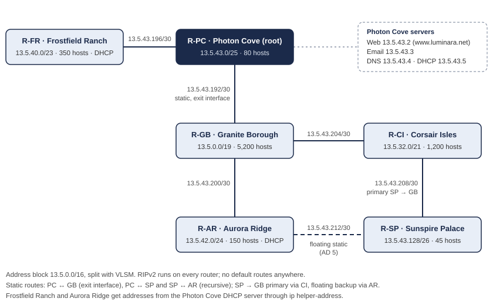

# LUMINARA: Six-Site Routed Network in Cisco Packet Tracer

A complete network for a fictional six-region kingdom, built in Cisco Packet Tracer for CSE421 (Computer Networks) at BRAC University. It covers VLSM addressing, mixed static and RIPv2 routing with a floating backup route, DHCP relay, and DNS, web and email services.

## Requirements

- Six locations, each its own network behind a router, needing between 45 and 5,200 hosts.
- One assigned block, `13.5.0.0/16`, split with VLSM so every location gets its own subnet.
- Links follow the shortest distances between sites, with Photon Cove as the root.
- Static routes on three router pairs only, RIPv2 everywhere else, and no default routes anywhere.
- A primary route from Sunspire Palace to Granite Borough plus a floating static backup through Aurora Ridge.
- Web, DNS and email servers in Photon Cove. `www.luminara.net` must load from every site, and email must work between users in Sunspire Palace, Photon Cove and Granite Borough.
- Frostfield Ranch and Aurora Ridge get their addresses by DHCP from a server in Photon Cove.

## Addressing

LAN subnets, sized largest first:

| Location | Router | Hosts needed | Subnet | Usable hosts | Gateway |
|---|---|---|---|---|---|
| Granite Borough | R-GB | 5,200 | 13.5.0.0/19 | 8,190 | 13.5.0.1 |
| Corsair Isles | R-CI | 1,200 | 13.5.32.0/21 | 2,046 | 13.5.32.1 |
| Frostfield Ranch | R-FR | 350 | 13.5.40.0/23 | 510 | 13.5.40.1 |
| Aurora Ridge | R-AR | 150 | 13.5.42.0/24 | 254 | 13.5.42.1 |
| Photon Cove | R-PC | 80 | 13.5.43.0/25 | 126 | 13.5.43.1 |
| Sunspire Palace | R-SP | 45 | 13.5.43.128/26 | 62 | 13.5.43.129 |

Point-to-point serial links:

| Link | Subnet | Addresses |
|---|---|---|
| R-PC ↔ R-GB | 13.5.43.192/30 | .193 / .194 |
| R-PC ↔ R-FR | 13.5.43.196/30 | .197 / .198 |
| R-GB ↔ R-AR | 13.5.43.200/30 | .201 / .202 |
| R-GB ↔ R-CI | 13.5.43.204/30 | .205 / .206 |
| R-CI ↔ R-SP | 13.5.43.208/30 | .209 / .210 |
| R-AR ↔ R-SP | 13.5.43.212/30 | .213 / .214 |

The hand-drawn VLSM tree is in [`docs/vlsm_tree.jpg`](docs/vlsm_tree.jpg), and every interface address is in [`docs/IP_Address_Table.xlsx`](docs/IP_Address_Table.xlsx).

## Routing

- **RIPv2** with `no auto-summary` runs on all six routers.
- **R-PC** reaches the Granite Borough LAN through a static route out of its directly attached interface `Serial0/0/0`, and the Sunspire Palace LAN through a recursive static route via `13.5.43.194`.
- **R-SP** has recursive static routes to the Photon Cove and Aurora Ridge LANs. Its route to Granite Borough goes through R-CI (`13.5.43.209`), with a **floating static route** through R-AR (`13.5.43.213`, administrative distance 5) that takes over if the primary path fails.
- **R-AR** has a recursive static route back to the Sunspire Palace LAN.
- **R-GB** redistributes its static route into RIP, and split horizon is disabled on the R-GB ↔ R-CI link.

Each router's full configuration is in [`configs/`](configs).

## Services

| Server | Address | Role |
|---|---|---|
| Web | 13.5.43.2 | Hosts `www.luminara.net` with the "Welcome to the Crystal Realm of LUMINARA" homepage |
| Email | 13.5.43.3 | Mail between Sunspire Palace, Photon Cove and Granite Borough users |
| DNS | 13.5.43.4 | Resolves `www.luminara.net` |
| DHCP | 13.5.43.5 | Address pools for Frostfield Ranch and Aurora Ridge, reached through `ip helper-address` on R-FR and R-AR |

## Verification

- Ping succeeds between devices in every pair of locations.
- `www.luminara.net` loads from all six networks.
- Email is delivered between users on different LANs.

## Files

| Path | Contents |
|---|---|
| `LUMINARA.pkt` | The full network. Open it with Cisco Packet Tracer. |
| `configs/` | Running configuration of each router |
| `docs/topology.svg` | Topology diagram shown above |
| `docs/vlsm_tree.jpg` | Hand-drawn VLSM subnetting tree |
| `docs/IP_Address_Table.xlsx` | Interface and host addressing table |
| `docs/VLSM_Tree_IP_Table_Config.pdf` | Submitted document with the VLSM tree, IP table and router configurations |

## Team

| Member | Contributions |
|---|---|
| Mohammed Mashrekin Yakub | R-SP, R-PC and R-FR configuration; web, DNS and email servers; DHCP server and relay; testing and verification |
| Faiza Zaman | R-GB, R-CI and R-AR configuration; VLSM subnetting; IP addressing table; topology diagram |
